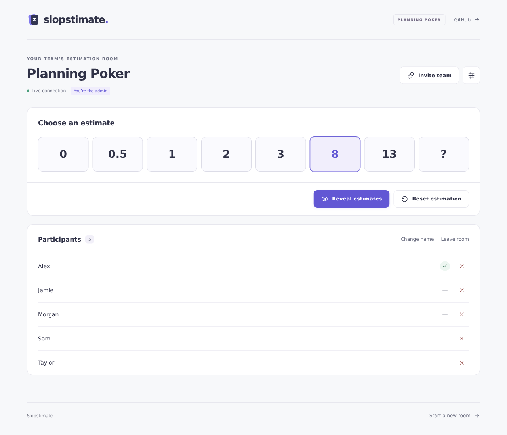
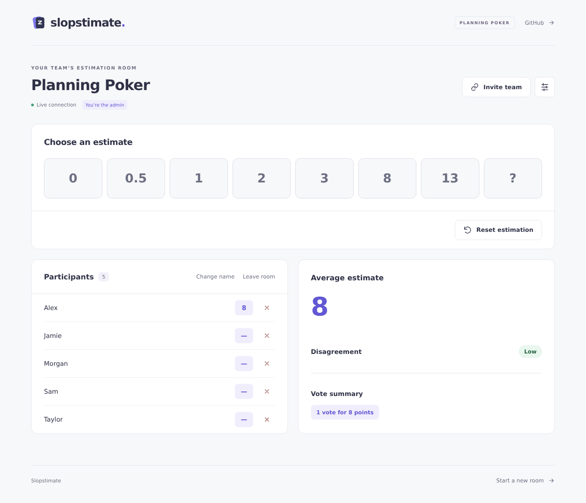

# Slopstimate

A small, self-hostable planning poker app for teams that want to estimate together and reuse the same room next week.

[](https://deploy.workers.cloudflare.com/?url=https://github.com/phil1995/Slopstimate)
[](https://github.com/phil1995/Slopstimate/actions/workflows/ci.yml)
[](LICENSE)





- Create a room and share its link. No accounts or invitations to manage.
- Choose an estimate privately, reveal together, and reset the estimation.
- Start with `0, 0.5, 1, 2, 3, 8, 13, ?`. The `?` choice skips an estimate. Fibonacci, T-shirt sizes, and custom decks are also available.
- Any joined participant can reveal estimates for everyone. Results appear beside each name in the participant list.
- See the average, disagreement rating, and counts for each vote after reveal, beside the participants on wider screens or below them on smaller screens. Skipped and nonnumeric choices are excluded from numeric statistics but included in the vote summary. Disagreement measures relative numeric spread; its calculation is documented in [the protocol](docs/PROTOCOL.md).
- Admins can remove connected or stale saved members from the roster.
- Keep the room, settings, and browser identities across weekly meetings.
- See every participant in one list below the estimate boxes. Multiple tabs count once.
- Facilitate without voting, rename yourself, leave a room, or delete it as its admin.
- Use the app on a phone or laptop with keyboard controls and visible reconnect states.

No stories, archives, analytics, or vote history. Only the current estimation is stored; resetting overwrites its votes. Rooms never automatically expire. Anyone with the room link can join, so share it with your team.

## Deploy to your own Cloudflare account

1. Click **Deploy to Cloudflare** above.
2. Sign in to your own Cloudflare account and to GitHub when requested.
3. Authorize Cloudflare to create a copy of the repository in your GitHub account.
4. Review the project and Worker name. Accept the detected build command (`npm run build`) and deploy command (`npm run deploy`).
5. Deploy. Cloudflare provisions the SQLite-backed Durable Object binding from `wrangler.jsonc`.
6. Open the provided `https://…workers.dev` URL, create a room, and share its `/r/…` link.

No manual D1, KV, R2, OAuth, or API key setup is required. One Worker serves the Svelte frontend, API, and live room connections. You need your own Cloudflare account; Workers Free eligibility, quotas, and account requirements can change. A credit-card-free experience is not guaranteed for every account or location. Check the current [Workers pricing](https://developers.cloudflare.com/workers/platform/pricing/) and [Durable Objects limits](https://developers.cloudflare.com/durable-objects/platform/limits/).

**Verification status:** local Workers runtime tests, browser checks, and a Wrangler deployment dry run are covered. Fresh-account deployment through the badge still needs live verification; see [the deployment checklist](docs/DEPLOYMENT_CHECKLIST.md). The badge is configured for this public repository, but local validation cannot establish Cloudflare account eligibility or a successful hosted build.

Cloudflare's Git integration can optionally redeploy your copy when you push changes. GitHub Actions validates pull requests and `main` without deployment secrets; it does not deploy the app.

### Manual deployment

Install Node.js 24 or newer, clone this repository, and run:

```sh
npm ci
npm run build
npx wrangler login
npm run deploy
```

Wrangler creates the Durable Object namespace using the single `v1` SQLite migration. Keep that migration and the `ROOM` binding stable on subsequent deployments to preserve your rooms. The deploy script always builds the frontend first.

Existing rooms keep their saved deck. To use the team deck in one, select **Room settings → Team default → Save settings**; changing the deck resets the estimation.

## Keep your room access

The creating browser stores a room-specific admin secret in `localStorage` **before** opening the room. Reopening that URL in the same browser restores admin controls. The shared URL never contains this secret.

There is no recovery or ownership transfer. Clearing browser storage, using another browser/device/origin, or losing the secret loses admin access. Create a new room if that happens. Moving from `workers.dev` to a custom domain also changes browser storage: start rooms on the domain you intend to keep.

Joining requires a trimmed display name of 1–40 characters; duplicate names are allowed. Separate participant identities keep people with the same name distinct. Joining stores a separate participant secret and your display name for that room. **Leave room** removes your membership and vote and forgets your participant identity on this device; every tab using that membership is disconnected. An admin who leaves as a participant keeps their separate admin access. Offline memberships remain until their owner leaves, the admin removes them, or the admin deletes the room. Admin removal also removes the current vote and revokes every connected tab for that membership. A removed person can join again with a name using the room link.

## Local development

```sh
npm ci
npm run dev
```

Open `http://localhost:8787`. This builds the frontend and starts Wrangler with the real local Durable Object runtime, rate limiting, static assets, and SPA route fallback. Local durable state persists in `.wrangler/`. Rebuild after frontend edits (`npm run build`); Wrangler reloads Worker changes automatically.

For frontend hot reload, leave Wrangler running and start another terminal:

```sh
npm run dev:ui
```

Open `http://localhost:5173`. Its API/WebSocket proxy reaches Wrangler on 8787. For this optional development mode, create an untracked `.dev.vars` file containing `ALLOWED_ORIGINS=http://localhost:5173` and restart Wrangler. Browser storage is scoped to each origin, so 5173 and 8787 have different identities. Production uses one origin and needs no environment variables.

### Checks

```sh
npm run check           # Svelte and TypeScript, including Worker and test code
npm test                # Actual workerd/SQLite integration tests
npm run format:check
npm run deploy:check    # Build assets and validate the deployment bundle offline
```

Tests cover authorization, every unrevealed HTTP/socket snapshot, vote replacement, locked/repeated/stale actions, concurrent resets, settings, multiple tabs, presence, actual socket hibernation, complete runtime restarts, token revocation, deletion tombstones, input limits, and abuse limits. Test storage is isolated in temporary directories. Miniflare is pinned to the runtime version used by the installed Wrangler; upgrade these together.

## Architecture and limits

See [SPEC.md](SPEC.md) for the original product specification and [docs/PROTOCOL.md](docs/PROTOCOL.md) for the implemented API.

One SQLite-backed Durable Object owns each room. Current room state is persisted after every mutation, with one serializer for authenticated HTTP and WebSocket snapshots. Actual vote fields are absent before reveal, even for the admin. Hibernating socket attachments contain verified member IDs and roles, never plaintext secrets. An alarm closes incomplete WebSocket handshakes; it never expires a room.

Basic limits are deliberately small: 50 saved members and 100 connections per room, 4 KB HTTP bodies, 1 KB WebSocket frames, 40-character names, and 80-character room titles. Platform limits are 10 room creations and 240 API requests per minute per IP per Cloudflare location. Durable room limits are 600 changes per minute overall, 60 changes per bearer identity, and 30 join/connection attempts per IP. Shared networks can hit IP-based limits; wait a minute or close unused tabs. IPs are abuse signals, never identities or authentication boundaries. The platform rate limiter is approximate and local to each Cloudflare location.

Same-origin checks work on both your `workers.dev` domain and custom domains. The optional `ALLOWED_ORIGINS` variable accepts comma-separated **exact** additional origins; leave it unset for normal deployments. Static assets apply a restrictive Content Security Policy and standard security headers. There are no third-party frontend scripts or unsafe HTML rendering.

Contributions are welcome: see [CONTRIBUTING.md](CONTRIBUTING.md) and [SECURITY.md](SECURITY.md). Licensed under [MIT](LICENSE).
